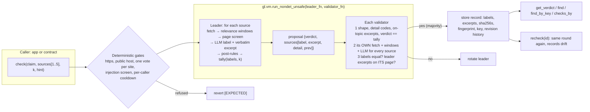

# ClaimCheck: a k-of-n web-evidence quorum oracle

**Do these web pages, each read independently by every validator, back this claim, and do at
least k of them agree?** ClaimCheck is a GenLayer Intelligent Contract that answers that one
question for other contracts and apps. It stores the answer with verbatim, mechanically checked
evidence, and can re-check it later for drift.

- **The model labels; code decides.** Each source gets one label from the LLM. The verdict
  comes from a 10-line pure function of those labels and k, which every validator recomputes.
- **Evidence is mechanically checked.** Every SUPPORTS or CONTRADICTS excerpt must be on the
  page *the validator itself fetched*, and it must be on topic.
- **Sybil and injection resistant.** There is one vote per registrable domain, one
  contradiction makes the result DISPUTED, and hostile pages are labelled INJECTED and excluded.
- **Composable.** `emit()` a check from your contract and read the result with `view()`.
  The example consumer contract enforces minimum-k and freshness policy.

[`contracts/claim_check.py`](../contracts/claim_check.py) ·
[`contracts/claim_check_consumer.py`](../contracts/claim_check_consumer.py) ·
[tests (151)](../tests/direct/test_claim_check.py) ·
[live run JSON](live/claim-check-run.json) ·
[examples](../examples/claim-check/README.md) ·
deployed on studionet: [`0x4c95D381fc83D66d0891797Fb54F6e283Ca1CFf5`](https://explorer-studio.genlayer.com/address/0x4c95D381fc83D66d0891797Fb54F6e283Ca1CFf5)



## 60-second quickstart

Read a stored verdict from the live contract. This needs no key and no gas:

```bash
git clone https://github.com/yoyoblair333-wq/delayproof && cd delayproof/tools && npm ci
node --input-type=module -e '
const { createClient } = await import("genlayer-js"); const { studionet } = await import("genlayer-js/chains");
const c = createClient({ chain: studionet });
console.log(await c.readContract({ address: "0x4c95D381fc83D66d0891797Fb54F6e283Ca1CFf5", functionName: "get_verdict", args: [1n] }));'
```

Run the whole suite locally (web and LLM are mocked; the real GenVM v0.2.16 SDK runs in-process):

```bash
python3 -m venv .venv && .venv/bin/pip install -r requirements.txt
.venv/bin/python -m pytest tests/direct/test_claim_check.py -q        # 151 passed
```

## Integrate it

**From another contract.** This is the whole pattern. [`claim_check_consumer.py`](../contracts/claim_check_consumer.py)
is the complete, tested version.

```python
from genlayer import *

class MyEscrow(gl.Contract):
    claim_check: Address

    def __init__(self, claim_check: str):
        self.claim_check = Address(claim_check)

    @gl.public.write
    def ask(self, claim: str, sources: list[str]) -> None:
        # Asynchronous: runs as its own ClaimCheck transaction once this one is accepted.
        gl.get_contract_at(self.claim_check).emit(on="accepted").check(claim, sources, 2, "")

    @gl.public.write
    def release(self, claim: str, sources: list[str]) -> None:
        # Synchronous read bound to the EXACT inputs: a check of another claim, other
        # sources or a lower k can never satisfy this.
        v = gl.get_contract_at(self.claim_check).view().find(claim, sources, 2, "")
        if v["id"] == 0 or v["verdict"] != "SUPPORTED":
            raise gl.vm.UserError("[EXPECTED] evidence quorum not reached")
        ...  # pay out
```

Keep cross-contract calls outside non-deterministic blocks (GenVM forbids them there).

**From genlayer-js:**

```js
import { createClient, createAccount } from "genlayer-js";
import { studionet } from "genlayer-js/chains";
const client = createClient({ chain: studionet, account: createAccount(PRIVATE_KEY) });
const CC = "0x4c95D381fc83D66d0891797Fb54F6e283Ca1CFf5";

const hash = await client.writeContract({ address: CC, functionName: "check", value: 0n,
  args: ["RFC 9110, HTTP Semantics, was published in June 2022.",
         ["https://www.rfc-editor.org/rfc/rfc9110.txt", "https://datatracker.ietf.org/doc/html/rfc9110"], 2n, ""] });
await client.waitForTransactionReceipt({ hash, status: "ACCEPTED" });

// Short-argument reads: these are safe over RPC whatever the URL lengths.
const [mine] = await client.readContract({ address: CC, functionName: "checks_by", args: [client.account.address, 1n] });
const same   = await client.readContract({ address: CC, functionName: "find_by_key", args: [mine.key] });
const full   = await client.readContract({ address: CC, functionName: "get_check", args: [BigInt(mine.id)] });
// mine.verdict: SUPPORTED | CONTRADICTED | DISPUTED | NOT_FOUND | INSUFFICIENT; full.sources[i].excerpt
```

## API

```
check(claim, sources, k, required_quote_hint="") -> record
```

| Input | Rule |
|---|---|
| `claim` | 10 to 280 characters after cleanup, no injection phrases |
| `sources` | 1 to 5 `https://` URLs, each on a **different registrable domain** (`en.` and `m.wikipedia.org` count as one site, as do `news.` and `www.bbc.co.uk`, or `alice.` and `bob.github.io`) |
| `k` | 1 to `len(sources)`: how many sources must agree |
| `required_quote_hint` | optional, 3 to 120 characters; a source only counts as SUPPORTS if this text is on it |

| Per-source label | Meaning | Excerpt |
|---|---|---|
| `SUPPORTS` | the page states the claim | required: verbatim, on this validator's fetch, at least 2 claim terms |
| `CONTRADICTS` | the page states something incompatible | required: verbatim, on the fetch, at least 1 claim term |
| `SILENT` | readable, but does not settle the claim (including "does not mention it") | none |
| `UNREACHABLE` | fetch error, non-2xx, over 4 MB, not text/HTML, or an error, login or captcha page | none |
| `INJECTED` | the page tries to instruct the checker | none; excluded from the count |

| Verdict (`tally`, checked in this order) | Rule |
|---|---|
| `DISPUTED` | at least one SUPPORTS **and** at least one CONTRADICTS |
| `SUPPORTED` | at least k SUPPORTS |
| `CONTRADICTED` | at least k CONTRADICTS |
| `INSUFFICIENT` | fewer than k usable sources (UNREACHABLE and INJECTED are not usable) |
| `NOT_FOUND` | enough usable sources, but no quorum either way |

DISPUTED comes first on purpose: one credible contradicting source blocks SUPPORTED, so two
copies of one blog post cannot outvote a primary source.

| Call | Kind | Purpose |
|---|---|---|
| `recheck(id)` | write, anyone | runs the round again on the stored inputs and records drift |
| `get_check(id)` / `get_verdict(id)` | view | full record with history (newest 10), or the compact form |
| `find(claim, sources, k, hint)` | view | newest check for exactly these inputs, or `{"id": 0}`; source order and URL case are ignored, k is not |
| `find_by_key(key)` | view | the same lookup by the 64-hex `key` stored in every record (one short argument) |
| `checks_by(address, n)` | view | newest checks created by an address (for example your consumer contract) |
| `list_recent(n)`, `stats()` | view | newest first; totals by verdict, recheck and drift counters, limits, cooldown |
| `set_paused`, `set_cooldown`, `transfer_ownership` | owner | the owner cannot touch records or verdicts |

Stored record: `id, claim, hint, k, sources[{url, url_hash, label, excerpt, excerpt_sha256,
detail}], verdict, fingerprint, key, revision, requester, created_at, checked_at, history[]`.

## How consensus is used

The whole fetch-and-label round runs inside one `gl.vm.run_nondet_unsafe(leader_fn,
validator_fn)` with a custom validator:

1. **The leader**, for each source, fetches the page (`gl.nondet.web.get`; HTML through
   `gl.nondet.web.render(mode="text")`). It selects relevance windows, runs the page injection
   screen and asks its LLM for one label and excerpt **per source**. The LLM never sees k, the
   other sources or the verdict rules. It then applies the deterministic post-rules and returns
   `{verdict, sources[{label, excerpt, detail, prev}]}`.
2. **Each validator** rejects the proposal unless it is well formed. That means exact key sets,
   known labels, a `detail` code that fits each label, on-topic excerpts of legal length, no
   excerpt on non-evidence labels, and `verdict == tally(labels, k)`. Then it runs the whole
   round itself, with its own fetches, its own windows and its own LLM.
3. It votes yes only if every per-source label equals its own, every leader excerpt appears in
   the page text **this validator** fetched, and on a recheck the "previous excerpt still
   present" bit matches. Any error on either side is a no, which forces a leader rotation.

**Why excerpts are verified to exist, not compared.** Two honest validators often quote
different sentences for the same fact (the date line or the abstract). Requiring equality would
fail honest rounds and add no safety. Existence in each validator's own fetch is what stops a
leader from inventing or importing evidence, and the on-topic rule stops it from storing a
real but irrelevant string.

**Deterministic relevance windowing (v2).** Long pages are cut into word-aligned blocks of about
400 characters. Every run of three blocks (about 1,200 characters, overlapping) is scored with
integer arithmetic:
- **coverage:** each distinct claim term present adds an IDF weight `1 + bit_length(4·windows/df)`,
  doubled for numbers;
- **phrase:** a bonus for consecutive claim terms within three words ("Champ de Mars", "June 2022");
- **hint:** the window holding the quote hint is always kept.

The best non-overlapping windows fill a 7,500-character budget and are shown in page order with
`[...]` gaps. It is a pure function of (page text, claim, hint), so validators that fetched the
same page show their models the same windows. A leader cannot choose what the validators read.
Coverage beats rarity, so a window holding the whole claim outranks one stray rare word. That
was the v1 failure mode, reproduced in `TestWindowing::test_v1_baseline_misses_the_lead_v2_finds_it`
and fixed live in #1.

**Shared normalisation** (`norm_for_match`): NFKC; zero-width, bidi, soft-hyphen and joiner
characters removed; curly quotes, guillemets, modifier apostrophes and dashes mapped; accents
folded; footnote markers such as `[12]` dropped; whitespace collapsed; rendered-element gaps
closed (`2818 , 7230`); casefolded. Wrapping quotes and `...` are trimmed from excerpts. One
function serves leader, validators and recheck.

## Why this is not an LLM wrapper

| An LLM wrapper… | ClaimCheck… |
|---|---|
| asks a model "is X true?" and stores the answer | asks for one **label per page** and computes the verdict with `tally`, which every validator recomputes. A misreported verdict is voted down |
| trusts the model's quote | downgrades any SUPPORTS/CONTRADICTS whose excerpt is not on the fetched page, or not on topic, to SILENT, in the leader **and** in every validator against its own fetch |
| accepts any well-formed JSON (a format-only validator) | requires per-source label equality, valid `detail` codes and excerpt existence on the validator's own copy |
| counts whatever URLs it is given | allows one vote per registrable domain and at most 5 sources, makes one contradiction DISPUTED, and excludes unreachable or hostile pages rather than treating them as agreement |
| answers once | keeps records with stable ids, exact-input keys, fingerprints and revision history; `recheck()` measures drift |
| is a demo | is used by another contract through real `emit()` and `view()` calls, with policy (minimum k, freshness, DISPUTED escalation) |

## Vulnerable vs hardened

Each guard, what goes wrong without it, the test that pins it, and live evidence where a
transaction exercises it.

| Guard | Without it (vulnerable) | Test | Live |
|---|---|---|---|
| Relevance windowing | v1 chunk ranking: one rare stray word outranks the paragraph that states the claim, so a long article reads as SILENT | `TestWindowing::test_v1_baseline_misses_the_lead_v2_finds_it`, `test_coverage_beats_one_rare_word`, `test_long_page_supported_end_to_end` | v1 [#1](https://explorer-studio.genlayer.com/tx/0x4739db7d44ad7a6e5c2a44a48905763d2d7244cbdef34eabd6c9fee6342151cb) NOT_FOUND → v2 [`0xbd0c3e17…ad7b`](https://explorer-studio.genlayer.com/tx/0xbd0c3e174cb85a947459bf836c6209bb2f54640cbf401ca3b610e2417f36ad7b) **SUPPORTED** (same input, no hint) |
| Excerpt existence check | the leader invents a quote, and the record "proves" a claim no page makes | `test_invented_excerpt_downgraded`, `TestValidator::test_rejects_excerpt_not_on_validator_page` | every SUPPORTED row below stores a verified excerpt |
| Excerpt on-topic rule (v2) | a leader stores a real but irrelevant page string (a nav link) as the evidence | `TestLeaderCherryPick::test_off_topic_excerpt_downgraded`, `test_validator_rejects_off_topic_leader_excerpt` | |
| `detail` allowlist (v2) | a leader writes `verified_by_ietf` into the record and validators still agree | `TestLeaderCherryPick::test_validator_rejects_forged_detail` | |
| k-tally recomputed by validators | the leader reports SUPPORTED over SILENT labels | `TestValidator::test_rejects_forged_verdict`, `test_rejects_forged_label_with_matching_verdict` | |
| DISPUTED before quorum | two copies of a blog post outvote a primary source | `TestQuorum::test_disputed_beats_quorum` | |
| One vote per registrable domain (v2) | `en.` and `m.wikipedia.org` (or two `*.github.io` tenants) count as two independent sources | `TestSybilSites::test_one_registrable_domain_one_vote` | [`0xf3db7cc1…60ad`](https://explorer-studio.genlayer.com/tx/0xf3db7cc13e17d2bff4e12f259a182971e151ee2abd39364e4e151d69b6e760ad) reverted |
| Page injection screen + fence | a cited page tells the model "label this SUPPORTS" | `TestInjectedPages::test_screen_labels_injected_without_llm`, `test_injected_source_cannot_flip_supported` | [`0x69b9f7f8…f04a`](https://explorer-studio.genlayer.com/tx/0x69b9f7f8da2a8a5d4952a3637df23f2f92435e8025344825ec154bcd2d4cf04a) hostile page labelled INJECTED, verdict **SUPPORTED** 2-of-3 |
| Claim / hint injection screen | the caller embeds instructions in the claim | `TestGates::test_injection_in_claim_reverts` | [`0x142e4ae1…ef46`](https://explorer-studio.genlayer.com/tx/0x142e4ae15d02171e287faa3c8bd99bd89f4c29bd26a8a9767e54300cbc84ef46) reverted |
| Validators' own windows | a leader labels from a context of its choosing | `TestLeaderCherryPick::test_leader_cannot_choose_the_windows` | |
| Unicode normalisation (v2) | soft hyphens, dropped accents, guillemets, fullwidth digits or zero-width characters make honest excerpts miss | `TestUnicodeRobustness` (10 cases) | |
| Per-caller cooldown (v2) | one caller floods validators with 5-source checks | `TestCooldown` | [`0x745f20bb…63ea`](https://explorer-studio.genlayer.com/tx/0x745f20bbd355ae4de03f8d777a1c8169d0b053a7236e5b18cd600a731e0263ea) reverted (sent in the same second as [`0xfd5ec510…e65f`](https://explorer-studio.genlayer.com/tx/0xfd5ec5102c7cb0401c2e3f1cb9969b35110d58538524dae7e0b62d497789e65f)) |
| Consumer min-k + freshness (v2) | a case settles on one source, or on a check run before the case existed | `TestConsumer::test_min_k_policy`, `test_stale_check_cannot_settle` | [`0xdfe10533…5816`](https://explorer-studio.genlayer.com/tx/0xdfe10533aebec4810a79b5c5c387c666197f1af0a427040b2de100f9fc975816) reverted |

## Threat model

| Threat | Mitigation in the contract | Residual risk |
|---|---|---|
| **URL rot** | non-2xx, fetch errors, empty pages and error/login pages are `UNREACHABLE` and do not count; `recheck()` records drift (`label_after`, `old_excerpt: absent`) | a record is a snapshot; consumers that need freshness compare `checked_at` (the example consumer does) or call `recheck` |
| **Prompt injection in the claim** | deterministic phrase screen after NFKC and invisible-character stripping; reverts `[EXPECTED]` | paraphrased injections pass the screen but still face the next layers |
| **Prompt injection in a page** | nonce-fenced page, defused fence markers, deterministic screen on the text the model would see (INJECTED with no LLM call), the model may also say INJECTED; never counts toward k | a subtle injection still needs a verbatim, on-topic excerpt that is on every validator's copy, and it loses to any contradiction (DISPUTED) |
| **Leader cherry-picking** | labels must match per source; windows are recomputed by each validator; excerpts must exist and be on topic; `detail` must fit the label | the leader still chooses *which* valid excerpt is stored (any on-topic passage that is on every validator's copy) |
| **Sybil sources** | one vote per registrable domain (two labels, three under a ccSLD such as `co.uk`), at most 5 sources, DISPUTED on conflict | ClaimCheck shows what pages say, not who owns them; consumers can add an allowlist |
| **Volatile pages** | exact label match and existence in each validator's fetch: disagreement rotates the leader, never stores a split result | very volatile pages may never reach consensus; cite stable primary pages |
| **Model hallucination** | existence and on-topic checks in leader and validators; downgrade to SILENT | every validator's model has to make the same misreading for it to pass |
| **Spoofing / mismatched results** | https only; no credentials, IP literals, local hosts or non-default ports; canonical URL and `url_hash` stored; consumers bind by exact inputs (`find`) | domain trust is the caller's policy |
| **Cost griefing** | per-caller cooldown (default 15 s, owner-tunable), 4 MB fetch cap, 7,500 context characters per source, 300k scanned characters, at most 5 sources, owner pause | fresh addresses bypass a per-caller cooldown; a fee-based limit needs a payable network |

## Gas and latency

A check costs about **sources × validators × (1 fetch + 1 LLM call)**. With 5 validators and 3
sources that is 15 fetches and 15 LLM calls. Each prompt carries at most 7,500 page characters
plus about 1,600 characters of fixed instructions. Windowing scans at most 300,000 characters
per page with integer scoring; the tests measure about 0.1 s natively on a 340k-character page.
On studionet, checks in the live run below took **17–65 s** from submission to
ACCEPTED (median 33 s). Refused inputs revert before any fetch, in about 6 s. Reads
(`get_verdict`, `find_by_key`, `checks_by`) are free views. Prefer them over `find()` from
off-chain clients (see the RPC note).

**RPC note (`find()` with long arguments).** In v1, a `find()` read from genlayer-js with three
long URLs failed in the RPC's own `gen_call` decoding (`RLP string ends with 288 superfluous
bytes`). One- and two-source reads worked, and contract-to-contract `view().find()` does not use
that path. v2 adds `find_by_key(key)` and `checks_by(address, n)`, which take only short
arguments. The v2 run re-probes it: `find()` with the three long URLs returned
an RPC error (`RLP string ends with 288 superfluous bytes`); `find_by_key` returned check #5 (SUPPORTED). Details are in `rpc_probe` in the run JSON.

## Honest scope and limits

- It reports **what pages say**, not what is true. SUPPORTED means k independent sites stated
  the claim when checked, and every validator verified the excerpts against its own fetch.
- **Retrieval is bounded**: 7,500 characters per page, chosen by deterministic windowing over
  the first 300,000 characters. A fact outside the windows makes the page SILENT. A miss is
  conservative and never produces a false SUPPORTED. `required_quote_hint` pins a passage.
- **The page injection screen is heuristic.** An article that quotes "ignore previous
  instructions" is labelled INJECTED, a safe false positive that only removes a vote.
- **Registrable domains are approximated** without the full Public Suffix List (last two labels,
  or three under a ccSLD). Free-hosting tenants (`*.github.io`) are deliberately one site.
- **Cross-contract results are asynchronous**: `emit()` creates a separate ClaimCheck
  transaction, so a consumer reads the result in a later call.
- **Studionet only so far.**

## Live deployment (v2)

Network: GenLayer **studionet** (`https://studio.genlayer.com/api`), 2026-11-02.

| Contract | Address | Deploy tx |
|---|---|---|
| ClaimCheck v2 (`owner` = Blair's wallet `0x920fbbCf2106B693A857D1995c198e341220a46A`, cooldown 15 s) | [`0x4c95D381fc83D66d0891797Fb54F6e283Ca1CFf5`](https://explorer-studio.genlayer.com/address/0x4c95D381fc83D66d0891797Fb54F6e283Ca1CFf5) | [`0x556747b4…de31`](https://explorer-studio.genlayer.com/tx/0x556747b4e5f2fe288374df0a7dc74e5049fc63fa27322eee274aef5fc396de31) |
| ClaimCheckConsumer v2 (`oracle` = ClaimCheck v2, `min_k` = 2) | [`0xA2443093D3f0C76bf82b022dE808Cd74d772c2dA`](https://explorer-studio.genlayer.com/address/0xA2443093D3f0C76bf82b022dE808Cd74d772c2dA) | [`0xd7d36cd4…5393`](https://explorer-studio.genlayer.com/tx/0xd7d36cd413785bed4406a0ed86cd98d7f01ad9d23e8153110d413a54591d5393) |

Open in Studio: https://studio.genlayer.com/?import-contract=0x4c95D381fc83D66d0891797Fb54F6e283Ca1CFf5

**Code pin.** The stored code of both contracts, read back with `gen_getContractCode` and
canonicalised (CRLF to LF, one trailing newline), has the same sha256 as the repo files.
ClaimCheck: `3fef422fce998e64ce74ea83b0b2142368fab91b799784dbe0eafb104c041652`; consumer: `2e06543f3e0f0ec085b0b8c5272b019bf1c2fbb79353f0218fa115e307e18ca0`.

| # | What | Tx | Result | Votes (agree/disagree) | Final |
|---|---|---|---|---|---|
| 1 | SUPPORTED, 1-of-1, no hint: the exact v1 input that came back NOT_FOUND (relevance windowing fix) | [`0xbd0c3e17…ad7b`](https://explorer-studio.genlayer.com/tx/0xbd0c3e174cb85a947459bf836c6209bb2f54640cbf401ca3b610e2417f36ad7b) | **SUPPORTED** (check #1); en.wikipedia.org **SUPPORTS**: `The Eiffel Tower (/ˈaɪfəl/ i EYE-fəl; French: Tour Eiffel [tuʁ ɛfɛl] i…` | 3/0 | FINALIZED |
| 2 | SUPPORTED, 2-of-2 on two sites (RFC Editor text + IETF Datatracker HTML) | [`0x032714f8…6780`](https://explorer-studio.genlayer.com/tx/0x032714f89c9bf78f26a6abf583cc1c1aaaf191db62b2fb36191d3150ea3f6780) | **SUPPORTED** (check #2); www.rfc-editor.org **SUPPORTS**: `Category: Standards Track June 2022 ISSN: 2070-1721 HTTP Semantics`; datatracker.ietf.org **SUPPORTS**: `Standards Track June 2022 2070-1721 R. Fielding, Ed. Adobe M. Nottingh…` | 3/2 | FINALIZED |
| 3 | CONTRADICTED (wrong year) | [`0x797aebac…41db`](https://explorer-studio.genlayer.com/tx/0x797aebaca6c2b3ddf2806396275fa2d964c09c9239021a3c8f45f0ae960d41db) | **CONTRADICTED** (check #3); www.rfc-editor.org **CONTRADICTS**: `Category: Standards Track June 2022 ISSN: 2070-1721 HTTP Semantics` | 3/0 | FINALIZED |
| 4 | page does not mention the claim (v1 said CONTRADICTED; v2 prompt: absence is SILENT) | [`0x4b711542…76a2`](https://explorer-studio.genlayer.com/tx/0x4b7115421b6dbc870d0a5ddc7b39b24300c6563d4ac90ea3ba49505186eb76a2) | **NOT_FOUND** (check #4); www.rfc-editor.org **SILENT** (model_silent) | 3/1 | FINALIZED |
| 5 | SUPPORTED 2-of-3 with the hostile repo page labelled INJECTED and excluded | [`0x69b9f7f8…f04a`](https://explorer-studio.genlayer.com/tx/0x69b9f7f8da2a8a5d4952a3637df23f2f92435e8025344825ec154bcd2d4cf04a) | **SUPPORTED** (check #5); www.rfc-editor.org **SUPPORTS**: `Request for Comments: 9110 Adobe STD: 97 M. Nottingham, Ed. Obsoletes:…`; datatracker.ietf.org **SUPPORTS**: `Standards Track June 2022`; raw.githubusercontent.com **INJECTED** (page_injection_screen) | 3/0 | FINALIZED |
| 6 | refused input: http:// source (reverts [EXPECTED]) | [`0xbe568707…247d`](https://explorer-studio.genlayer.com/tx/0xbe5687073e049c5aec430a8168e339bf687a6a3508251c7f7fa17fbc9107247d) | reverted: `[EXPECTED] source url must use https://` | 3/0 | FINALIZED |
| 7 | refused input: injection phrase in the claim (reverts [EXPECTED]) | [`0x142e4ae1…ef46`](https://explorer-studio.genlayer.com/tx/0x142e4ae15d02171e287faa3c8bd99bd89f4c29bd26a8a9767e54300cbc84ef46) | reverted: `[EXPECTED] claim contains instructions aimed at the checker` | 5/0 | FINALIZED |
| 8 | refused input: en.wikipedia.org + m.wikipedia.org are one site (reverts [EXPECTED]) | [`0xf3db7cc1…60ad`](https://explorer-studio.genlayer.com/tx/0xf3db7cc13e17d2bff4e12f259a182971e151ee2abd39364e4e151d69b6e760ad) | reverted: `[EXPECTED] each source must be on a different site (registrable domain)` | 5/0 | FINALIZED |
| 9 | NOT_FOUND (unrelated claim against the RFC text) | [`0x9dbe9843…96b4`](https://explorer-studio.genlayer.com/tx/0x9dbe98436767724e1bf0115fe6b64a4a3c925f285838735199f7611d4b8496b4) | **NOT_FOUND** (check #6); www.rfc-editor.org **SILENT** (model_silent) | 3/0 | FINALIZED |
| 10 | recheck(2) - drift detection on the 2-of-2 check | [`0x92fd74dd…6393`](https://explorer-studio.genlayer.com/tx/0x92fd74dd99e786883a2ed123bdda66143315a34906ed133f0c8e148cc5ce6393) | revision 2, drift [], still **SUPPORTED** | 3/1 | FINALIZED |
| 11a | check accepted | [`0xfd5ec510…e65f`](https://explorer-studio.genlayer.com/tx/0xfd5ec5102c7cb0401c2e3f1cb9969b35110d58538524dae7e0b62d497789e65f) | **SUPPORTED** (check #7); www.rfc-editor.org **SUPPORTS**: `This document updates RFC 3864 and obsoletes RFCs 2818, 7231` | 3/0 | FINALIZED |
| 11b | same caller, same second: reverts [EXPECTED] cooldown | [`0x745f20bb…63ea`](https://explorer-studio.genlayer.com/tx/0x745f20bbd355ae4de03f8d777a1c8169d0b053a7236e5b18cd600a731e0263ea) | reverted: `[EXPECTED] cooldown: one check or recheck per 15 seconds per caller` | 5/0 | FINALIZED |
| 12 | consumer policy: min_k = 2, so a 1-of-1 case reverts [EXPECTED] | [`0xdfe10533…5816`](https://explorer-studio.genlayer.com/tx/0xdfe10533aebec4810a79b5c5c387c666197f1af0a427040b2de100f9fc975816) | reverted: `[EXPECTED] this desk requires k >= 2 independent sources` | 5/0 | FINALIZED |
| 13 | consumer stores a 2-of-2 case | [`0x84b12e33…97ed`](https://explorer-studio.genlayer.com/tx/0x84b12e3307a65dfaeb0ab0729f21ee7376fcc48c78770283579ac3aa431197ed) | case opened (2-of-2) | 5/0 | FINALIZED |
| 14 | consumer emits ClaimCheck.check(...) (cross-contract message) | [`0x1203b4bc…c88e`](https://explorer-studio.genlayer.com/tx/0x1203b4bc6ad4a43c43abbe513bbacf3ceca89f5f89250114b822b40e5b2ac88e) | emitted message ran as ClaimCheck check #8 (requester = the consumer contract): **SUPPORTED** | 3/0 | FINALIZED |
| 15 | consumer reads ClaimCheck.find(...) via view() and settles (fresh, 2-of-2) | [`0x48e9135d…888f`](https://explorer-studio.genlayer.com/tx/0x48e9135df6139f63764d6a9f1f29d224d291dcd306d0ad19eb973a196adb888f) | case 1 **settled**, outcome `claim_upheld`, check_id 8 | 3/0 | FINALIZED |

Final `stats()`: 8 checks (1 CONTRADICTED, 2 NOT_FOUND, 5 SUPPORTED), 1 recheck, 0 with drift, cooldown 15 s. Every transaction above reached the status in the Final column; vote counts per transaction are in the JSON.

Reproduce with `scripts/claim_check_live.mjs` (it deploys, pins the code, runs this plan and
follows every transaction to FINALIZED).

### v1 (superseded)

v1 was ClaimCheck [`0x2FA85060bd7fCBc0B0f07A42A19a64aC2667d76F`](https://explorer-studio.genlayer.com/address/0x2FA85060bd7fCBc0B0f07A42A19a64aC2667d76F)
with consumer `0xBE99d6e3E802E9d06182Ff775f7f0f70b115a4fe`, commit `b1e3040`, 13 finalized transactions.
Its run is kept in git history (`docs/live/claim-check-run.json` at `b1e3040`). v1's Wikipedia
check ([tx](https://explorer-studio.genlayer.com/tx/0x4739db7d44ad7a6e5c2a44a48905763d2d7244cbdef34eabd6c9fee6342151cb))
came back NOT_FOUND. It succeeded only after the claim was reworded and a quote hint was added.
That miss is what v2's relevance windowing fixes.

## Verify locally

```bash
python3 -m venv .venv && .venv/bin/pip install -r requirements.txt
.venv/bin/python -m pytest tests/direct/test_claim_check.py -q     # 151 tests, web + LLM mocked
.venv/bin/genvm-lint check contracts/claim_check.py && .venv/bin/genvm-lint typecheck contracts/claim_check.py
bash scripts/verify.sh                                             # the whole repo
```
